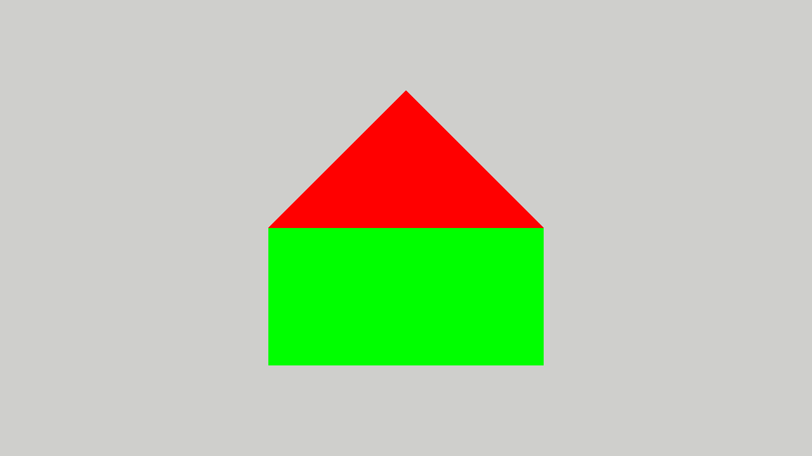
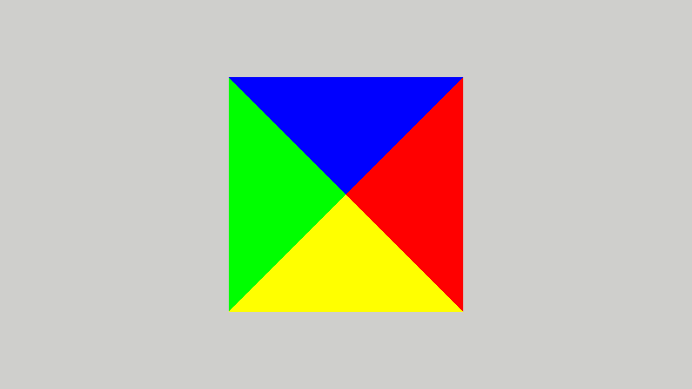

# Pyramid

In this assignment, you will finally create a true 3D object.
You will also learn how to use the depth buffer and how to cull faces.

Start by copying the `05_PVM` assignment to a new `06_Pyramid` directory, as described in the
[Preparing the assignments](../README.md#preparing-the-assignments) section.

1. First remove the `Mixer` interface block and all the associated code both in shaders and C++ files.
   You will not need it anymore.

2. Next set the model transformation to the identity and place the camera at (0,0,2) looking at (0,0,0) with up vector
   in the `y` direction. The result should look like this:

   <p align="center"></p>

## Direct state access for the vertex array

So far we have set up the vertex array object (VAO) by binding it and the vertex buffer, and then calling
`glVertexAttribPointer`, which records the format of an attribute together with the buffer that is _currently bound_ to
`GL_ARRAY_BUFFER`. We already create and fill the buffers with _direct state access_ (DSA) functions such as
`glCreateBuffers` and `glNamedBufferData`, which take the name of the object they modify instead of relying on what is
bound. We will now do the same for the VAO. The result on the screen should not change.

1. Replace `glGenVertexArrays` with `glCreateVertexArrays`. `glGenVertexArrays` only reserves a name; the object is
   created when it is first bound, and a DSA function called with a name that was never bound generates
   `GL_INVALID_OPERATION`.

2. A VAO has _binding points_ for vertex buffers, separate from the attributes. Attach the vertex buffer to binding
   point `0` with `glVertexArrayVertexBuffer`. The stride, the distance between consecutive vertices, belongs to the
   binding, so it is given only once, here. Attach the index buffer with `glVertexArrayElementBuffer`.

3. For each attribute, enable it with `glEnableVertexArrayAttrib`, describe its format with `glVertexArrayAttribFormat`
   and connect it to the binding point with `glVertexArrayAttribBinding`. For the position this is
   ```c++
   OGL_CALL(glEnableVertexArrayAttrib(vao_, 0));
   OGL_CALL(glVertexArrayAttribFormat(vao_, 0, 3, GL_FLOAT, GL_FALSE, 0));
   OGL_CALL(glVertexArrayAttribBinding(vao_, 0, 0));
   ```
   The last argument of `glVertexArrayAttribFormat` is the offset of the attribute _relative_ to the start of the
   vertex, a plain number, not a pointer. Do the same for the color attribute.

   Neither of the two mistakes below generates an OpenGL error, so check them carefully if nothing is drawn or the
   colors are wrong:
    - A disabled attribute is not read from the buffer; the shader gets the constant value (0,0,0,1) instead.
    - By default, attribute `i` reads from binding point `i`, so the color attribute has to be connected to binding
      point `0` explicitly.

4. Remove the `glBindVertexArray`, `glBindBuffer`, `glEnableVertexAttribArray` and `glVertexAttribPointer` calls from
   `init`. `glEnableVertexAttribArray` is replaced by `glEnableVertexArrayAttrib`; left in, it would act on whatever
   vertex array object happens to be bound, or generate `GL_INVALID_OPERATION` if none is. You still have to bind the
   VAO in `frame` before the draw call.

## Orientation and back-face culling

1. Before you create a pyramid, you have to understand the concept of _orientation_. Each triangle has a front and back
   face. Which is which depends on the order in which the vertices of the triangle were placed in the index buffer (or
   vertex buffer if the index buffer was not used). If looking at the triangle and enumerating the vertices in the order
   they have been placed in the index buffer we move in counterclockwise direction, we are looking at the front face. In
   the opposite case, we are looking at the back face. In general, all the triangles should have the same orientation.
   That is, the front face of one triangle should be adjacent to the front face of the neighbouring triangle.

   This enables the use of so-called _back-face culling_. This is an optimisation technique that hinges on the fact that
   the back faces of models which form a closed surface are never visible. So any pixel belonging to a back face will be
   eventually overwritten by a pixel belonging to a front face. The OpenGL engine detects back faces after the primitive
   assembly, before the rasterization, and discards them, saving potentially thousands of expensive fragment shader
   calls.

   To enable back-face culling you have to issue the following command before drawing the object:
   ```c++
   OGL_CALL(glEnable(GL_CULL_FACE));
   ```
   Do this at the end of the `init` method.
   If the output remains the same, it means that all the faces are front-facing.
   If the house disappears completely, it means that all the faces are back-facing.
   If some triangles disappear, then the orientations of the triangles were not consistent.
   Before proceeding further fix this so that all triangles have the same orientation.

## The pyramid

1. Keeping in mind the above consideration, please create a pyramid.
   The pyramid base should be a square with side length equal to one lying in the (x,y,0) plane and centered at
   (0,0,0).
   The apex of the pyramid should be at (0,0,1). Each side and the base of the pyramid should have a different color:
    - base: gray (0.5,0.5,0.5),
    - +x facing side: red (1,0,0),
    - -x facing side: green (0,1,0),
    - +y facing side: blue (0,0,1),
    - -y facing side: yellow (1,1,0).

   Use the index buffer and the smallest possible number of vertices in vertex buffer.

   Remember to change the number of indices (the `count` argument) in the `glDrawElements` call.

2. Switch on the depth buffer. This will enable the OpenGL engine to discard fragments that are behind other fragments.
   To do this issue the following command before drawing the object:

   ```c++
   OGL_CALL(glEnable(GL_DEPTH_TEST));
   ```
   The window already has a depth buffer and the `Application` class clears it at the start of every frame, so this
   is the only call you need.

   Actually, you will probably not see any difference. That's because of the enabled face culling. The back faces are not drawn, so they will not obscure the front faces.
   Disable the face culling temporarily and see the difference. You can do it by commenting out the `glEnable(GL_CULL_FACE)` command. You may have also to change the position of the camera to see any effect.

   Switch back to the original camera position as described at the beginning of this file.
   The correct result should look like this:

   <p align="center"></p>

3. Before submitting, check if the base has proper orientation.
   You can do it by changing the z coordinate of the camera
   position to -2.
   That way, the camera will look at the base of the pyramid.
   If the base is not visible, it means that the orientation of the triangles is wrong.
   Fix it before submitting then change the camera position back to (0,0,2).
